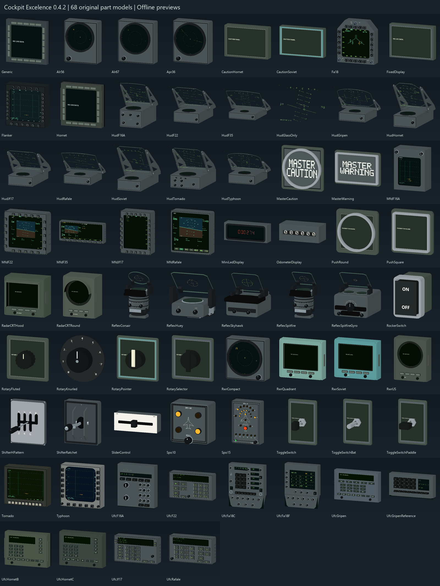

# Cockpit Excelence

Configurable cockpit displays and physical controls for **Flyout**.

**Current public version: 0.4.2** · **Windows x64 / .NET 6 IL2CPP**

[Download](https://github.com/Radio-Active1991/Cockpit-Excelence/releases/latest) · [Wiki](https://github.com/Radio-Active1991/Cockpit-Excelence/wiki) · [SDK and examples](https://github.com/Radio-Active1991/Cockpit-Excelence/wiki/Mod-Integration-and-SDK) · [Report an issue](https://github.com/Radio-Active1991/Cockpit-Excelence/issues)

Created by **Radio-Active1991** with extensive programming, debugging,
original-model and documentation assistance from **OpenAI ChatGPT / Codex**.

## Build your cockpit

- 68 original instrument/control parts: MFDs, HUDs, UFCs, warning panels,
  buttons, switches, rotary controls, slider, LED values, real number drums
  and gated H-pattern/ratchet shifters.
- Styles inspired by F/A-18, early F-16A, Gripen, Eurofighter, Tornado,
  Soviet instruments, Rafale, F-22, F-35 and JF-17.
- Editable flight, engine, grouped-fuel, stores, radar, RWR, navigation and
  weapon pages. Transfer pages across aircraft; share bezel shortcuts and
  scroll long lists. F-35 halves can work independently or as one wide page.
- Configurable HUD modes, reticles, FoV, tapes, radar-height factors and masks.
- Per-UFC DD.DDDD/DD MM.MMM coordinates and hemisphere keys. Native AP
  IAS/TAS/Mach targets on UFC/MFD, LED/drums and physical controls.
- Warning rules/outputs/tones, stall alerts, supported stock actions, native
  motor/rocket/gearbox data, gear/clutch controls and separate gear indicators.
- Adjustable image resolution/refresh/work budgets, required-axis polling,
  reuse of unchanged images and external-view freeze.
- **Display SDK v1:** another mod can publish images or drawing commands into
  a normal page widget. Three working examples and a separate SDK download.

These are configurable Flyout-adapted instruments, not complete reference-
aircraft avionics simulations. Cameras/FLIR/Mi8 video and native GPS targeting
remain **WIP**. Cockpit scope only; airframe physics belong to their own mod.

## Downloads and installation

| Release asset | Contents |
| --- | --- |
| **Cockpit-Excelence-0.4.2.zip** | Game files, installation and license notices |
| **Cockpit-Excelence-0.4.2-Source.zip** | Complete source, tests, model tools/assets and bilingual help |
| **Cockpit-Excelence-0.4.2-SDK.zip** | Developer API/reference DLL, examples and build helpers |

Players only need the first ZIP. Install **both Mods and Parts** in their
respective game/user folders: [installation guide](https://github.com/Radio-Active1991/Cockpit-Excelence/wiki/Installation).
Keep layouts, UserData and aircraft saves. Stable part IDs and FlyoutMFD.dll
remain unchanged. Do not install a second copy from the optional SDK.

See [what changed](https://github.com/Radio-Active1991/Cockpit-Excelence/wiki/Release-0.4.2),
[coordinate examples](https://github.com/Radio-Active1991/Cockpit-Excelence/wiki/Navigation-UFC-and-Autopilot),
[shifter setup](https://github.com/Radio-Active1991/Cockpit-Excelence/wiki/Shifters-and-Gearboxes),
[resolution/refresh](https://github.com/Radio-Active1991/Cockpit-Excelence/wiki/Performance) and
[HUD FoV](https://github.com/Radio-Active1991/Cockpit-Excelence/wiki/HUD#adjusting-hud-fov).

## For mod authors

Reference the matching host assembly and register one stable source. Publish
RGBA or bounded text/line/rectangle/ellipse commands, then let the user select
it in **External mod content**. Normal page limits and freeze apply.
This is render-only API v1, not a GPU-texture/camera/input callback interface.

[Integration guide](https://github.com/Radio-Active1991/Cockpit-Excelence/wiki/Mod-Integration-and-SDK) ·
[Three simple examples](https://github.com/Radio-Active1991/Cockpit-Excelence/wiki/SDK-Examples) ·
[API contract](docs/SDK/EXTERNAL_DISPLAY_API.md)

## Verification and limits

0.4.2 passed8184controlled checks/12suites,586model/layout alignment checks
and154compiled production contracts. All894direct native references and
13existing hooks resolved on the inspected Flyout0.2504baseline.9151Unity
proxy paths contained no known throwing stub. Source rebuild and standalone
SDK archive checks are reported with release hashes.

The SDK consumer executes only the owned managed API and examples. Offline
checks do not establish native GPU appearance or measured FPS improvements.
Include versions, reproduction steps and a relevant log excerpt in bug reports.

GPL-3.0: [license](LICENSE) and [corresponding source](https://github.com/Radio-Active1991/Cockpit-Excelence/wiki/License-and-Source).
No game, loader, Mi8 or other foreign mod binary, private development log or
third-party reference photograph is distributed.
